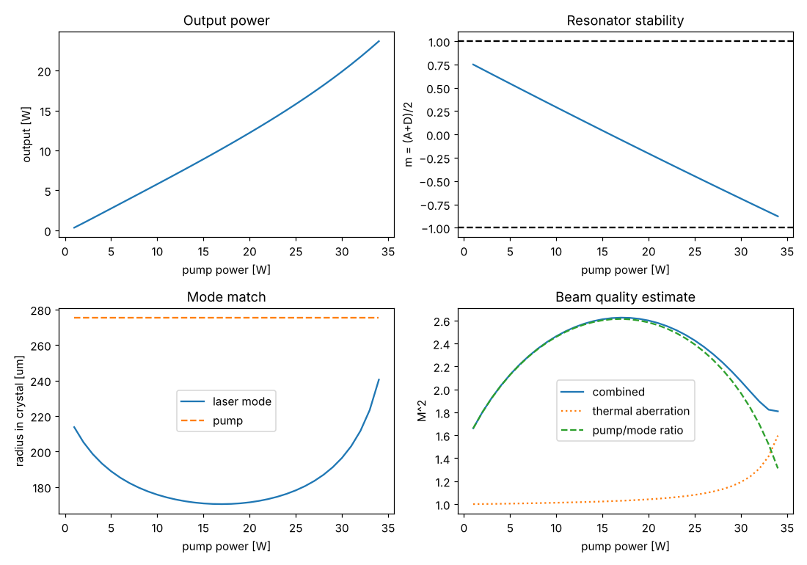
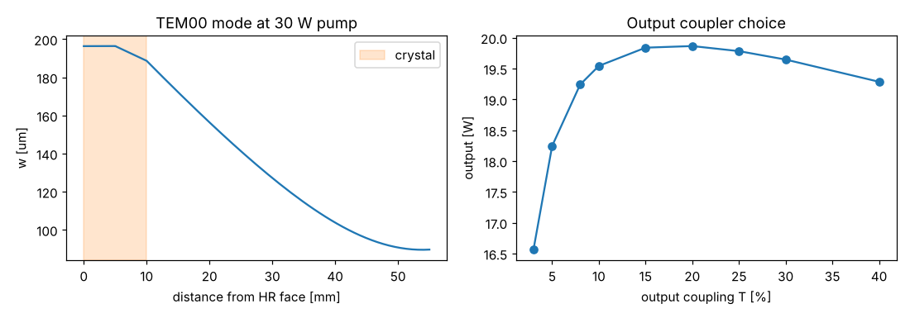

# CW end-pumped Nd:YVO4

Script: `examples/cw_nd_yvo4.py`

## Design

| Parameter | Value |
|---|---|
| Gain medium | Nd:YVO4, 0.27 at.%, 10 mm, a-cut, π-polarised |
| Pump | 30 W at 808 nm from a 400 µm / 0.22 NA fibre (M² ≈ 170), focused to a 250 µm waist 2 mm inside the crystal |
| Resonator | HR coating on the pumped face, 45 mm air gap, R = 500 mm output coupler |
| Output coupling | 20 % (optimum found by the script), 1 % other losses |

## Results at 30 W pump

| Quantity | Value |
|---|---|
| Absorbed fraction | 1.00 |
| Absorption-weighted pump radius | 275 µm |
| Thermal focal length | 58 mm |
| Stability parameter m | −0.69 |
| Laser mode radius in crystal | 196 µm |
| Output power | 19.9 W (66 % optical efficiency, idealised) |
| M² estimate | 2.1 |
| Stable up to | 34 W pump |

## What the design shows

The thermal lens (58 mm at full power) dominates the resonator. As the pump
power rises the stability parameter falls steadily from +0.75 towards −1. The
laser mode in the crystal first shrinks and then grows as the cavity
approaches the edge of stability.

The fibre-coupled pump's poor beam quality makes the absorption-weighted pump
radius (275 µm) larger than the focused waist. To get good beam quality the
mode needs to fill the pump, but in this resonator that only happens near the
stability edge. The 45 mm gap is a compromise: the mode reaches about 0.7 of
the pump radius at full power, M² is estimated at about 2, and there is
margin to about 34 W before the resonator goes unstable. A longer gap gives a
larger mode and better M² at 30 W but leaves no margin; a shorter gap is
robust but multimode.

The output coupler scan shows a broad optimum around 15 to 25 %, typical of
high-gain Nd:YVO4.

## Things to try

- Reduce the pump waist to 200 µm: a stronger thermal lens, and better mode
  matching at lower power.
- Use a better pump (lower `m2`) to see how much the pump divergence costs.
- Replace Nd:YVO4 by Nd:YAG (`get_material("Nd:YAG")`, 1 at.%) and note how
  much stronger its thermal lens is for the same heat load.
