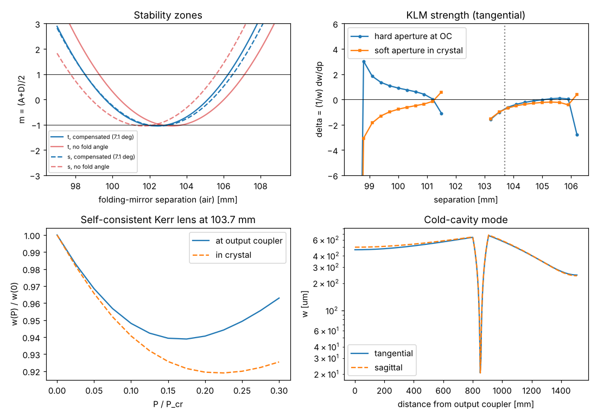

# Kerr-lens mode-locked Ti:sapphire

Script: `examples/klm_ti_sapphire.py`. Theory: {doc}`../theory/kerr_lens`.

## Design

| Parameter | Value |
|---|---|
| Crystal | Ti:sapphire, 4 mm path, Brewster-cut, n₂ = 3.2×10⁻²⁰ m²/W |
| Folding mirrors | R = 100 mm, 7.1° angle of incidence (astigmatism compensated) |
| Arms | 800 mm to a flat output coupler, 600 mm to a flat HR (behind the prisms) |
| Output | 0.5 W average at 5 % output coupling, 15 fs target |

## Results

| Quantity | Value |
|---|---|
| Compensating fold angle | 7.1° |
| Critical power P_cr | 1.8 MW |
| Stability zones (air path between folding mirrors) | 98.5 to 101.5 mm and 103.2 to 106.2 mm |
| Operating point | 103.7 mm (inner edge of the second zone) |
| KLM strength, hard aperture at the OC | −0.73 |
| KLM strength, soft aperture in the crystal | −0.76 |
| Repetition rate | 99 MHz |
| Intracavity pulse energy | 101 nJ |
| Peak power / P_cr | 3.3 |
| Mode in the crystal | 44 × 27 µm |
| Net GDD for a 15 fs soliton | −230 fs² per round trip |
| Crystal GDD (two passes) | +464 fs² |
| GDD the prisms must supply | about −690 fs² |

## What the design shows

- **Astigmatism.** Without the fold angle the tangential and sagittal zones
  are shifted by about 1 mm, so there is hardly a separation where both are
  well inside; at 7.1° they coincide (upper left).
- **Two zones, opposite behaviour.** The asymmetric arms split the stable
  range into two zones. The KLM strength changes sign across each zone and
  its magnitude grows at the edges (upper right), so the alignment for
  hard-aperture KLM is near an edge where δ at the output coupler is
  negative.
- **Soft aperture.** In the second zone the Kerr lens shrinks the mode in the
  crystal (δ < 0), so with a pump spot comparable to the mode the pulse sees
  more gain. This is how most practical Ti:sapphire oscillators start.
- **Beyond small signal.** The self-consistent solution (lower left) shows the
  mode shrinking and then recovering as the power grows: the linear δ only
  describes the onset. Real operation at p ≈ 3 is outside the thin-slice
  model's comfortable range; use it for trends.
- **Dispersion.** The crystal adds +464 fs², so the prism pair must supply
  roughly −700 fs² for 15 fs solitons at this pulse energy.
