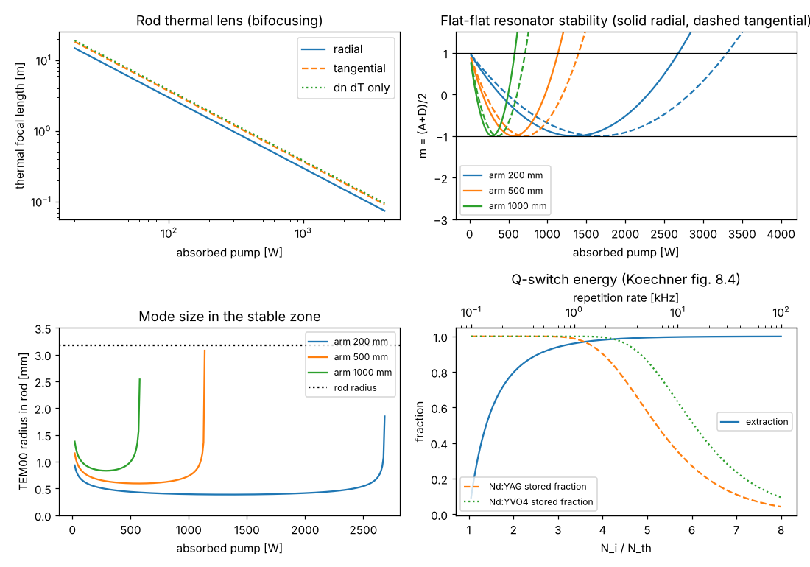

# Side-pumped Nd:YAG rod (after Koechner)

Script: `examples/koechner_side_pumped_rod.py`

This example follows Koechner, *Solid-State Laser Engineering*, chapters 5, 7
and 8. The rod dimensions (6.35 mm × 75 mm) and the photo-elastic
coefficients ($C_r = 0.017$, $C_\phi = -0.0025$) are typical of Koechner's
treatment but were entered from memory. Please check them against the book.

## Thermal lens and bifocusing

For a uniformly pumped rod (Koechner eq. 7.41) with 32 % of the absorbed
diode power turned into heat:

| At 500 W absorbed | Value |
|---|---|
| Focal length, dn/dT only | 759 mm |
| Radial polarisation | 592 mm |
| Tangential polarisation | 730 mm |
| Bifocal ratio $f_r/f_\phi$ | 0.81 |
| Centre-to-surface temperature rise | 12 K |
| Fracture limit (8πR_T L) | 1.5 kW of heat, about 4.7 kW absorbed |

Stress birefringence makes the rod a stronger lens for radially polarised
light. An unpolarised beam therefore sees two focal lengths at once, which
limits beam quality and depolarises the beam.

## The thermally loaded resonator

A flat-flat resonator with the rod in the middle is marginally stable when
cold. The thermal lens makes it stable, and it stays stable until the lens
becomes too strong for the arm length (Koechner sec. 5.1):

| Arm length | Stable pump range, radial | Stable pump range, tangential |
|---|---|---|
| 200 mm | up to 2.7 kW | up to 3.3 kW |
| 500 mm | up to 1.1 kW | up to 1.4 kW |
| 1000 mm | up to 0.58 kW | up to 0.71 kW |

The stable range in pump power scales inversely with arm length. Because of
bifocusing, the two polarisations leave the stable zone at different powers,
so a laser near the edge of its range shows strong depolarisation loss. In the
middle of the stable zone the TEM00 radius in the rod is nearly constant (the
"dynamically stable" operating point). Short resonators give small modes that
fill only a small fraction of the rod, which is why high-power rod lasers run
multimode.

## Q-switch energy

The lower-right panel reproduces the energy extraction curve of Koechner fig.
8.4 (80 % at $N_i/N_{th} = 2$, 99 % at 5). It also shows the fraction of the
asymptotic stored energy reached between pulses,
$1 - e^{-1/(f\tau)}$, for Nd:YAG (230 µs) and Nd:YVO4 (100 µs). Nd:YAG keeps
its full stored energy up to about 1 kHz, while Nd:YVO4 is already losing
energy there. This is the main reason Nd:YAG is chosen for high-energy,
low-repetition-rate Q-switched lasers.
