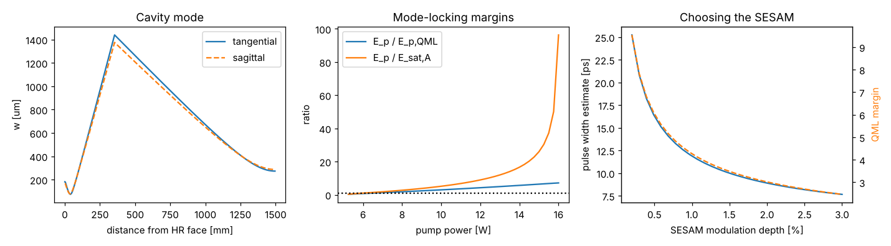

# SESAM mode-locked Nd:YVO4

Script: `examples/modelocked_nd_yvo4_sesam.py`

## Design

| Parameter | Value |
|---|---|
| Gain medium | Nd:YVO4, 0.5 at.%, 4 mm |
| Pump | 12 W at 808 nm, M² = 30, 150 µm waist |
| Resonator | HR on the pumped face → 350 mm → curved fold mirror (R = 500 mm, 5°) → long arm with a flat 5 % output-coupling fold mirror → SESAM |
| Optical length | 1.5 m (100 MHz) |
| SESAM | 60 µJ/cm² saturation fluence, 1 % modulation depth |

## Results at 12 W pump

| Quantity | Value |
|---|---|
| Repetition rate | 99.9 MHz |
| Average output | 6.5 W (two beams from the fold output coupler) |
| Mode / pump radius in crystal | 182 µm / 151 µm |
| Mode radius on SESAM | 274 µm |
| Stability (tangential / sagittal) | −0.26 / −0.09 |
| Intracavity pulse energy | 1.26 µJ |
| QML threshold | 0.30 µJ (margin 4.3) |
| SESAM saturation E_p/E_sat,A | 9 |
| Pulse width estimate | 12 ps (transform limit 1.2 ps) |
| Active AM mode locking, same cavity | 52 ps |
| Stable pump range | 5.3 to 16 W |

## What the design shows

- The long cavity puts a lot of energy in each pulse, so QML is not a problem
  above about 6 W of pump. A shorter, higher-repetition-rate cavity would need
  a smaller mode on the SESAM or a lower-fluence SESAM. Try halving
  `TOTAL_OPTICAL_LENGTH` and watch the QML margin.
- The SESAM spot is chosen to saturate it about ten times. Near the top of the
  stable pump range the mode on the SESAM shrinks and the saturation shoots
  up, which risks SESAM damage. This is a reason to operate mid-range.
- The off-axis fold mirror makes the mode slightly astigmatic. A 5° fold angle
  is small enough that both planes stay well inside the stable range.
- Passive mode locking with a 1 % SESAM gives pulses around 10 ps, about 4×
  shorter than active AM mode locking of the same cavity. Getting close to
  the 1 ps transform limit of Nd:YVO4 needs a larger modulation depth or
  soliton shaping, both of which raise the QML threshold.
