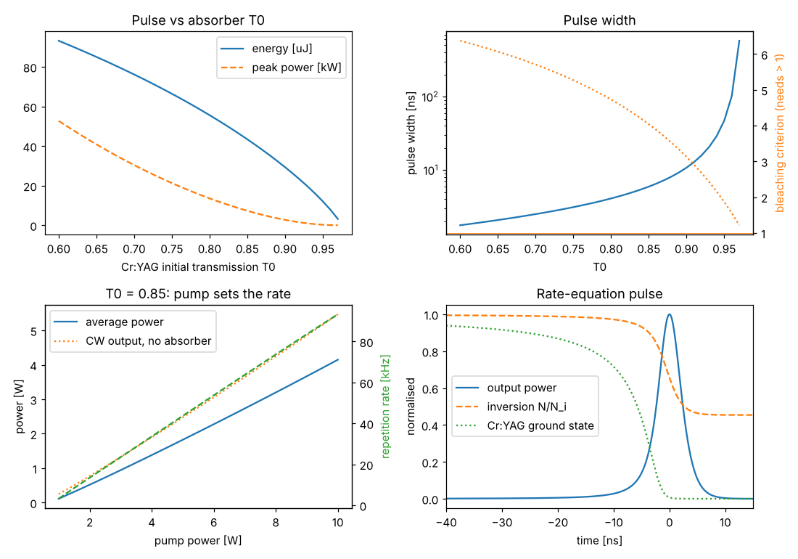

# Passively Q-switched Nd:YAG / Cr:YAG

Script: `examples/passive_qswitch_nd_yag_cr_yag.py`. Theory:
{doc}`../theory/passive_qswitching`.

## Design

| Parameter | Value |
|---|---|
| Gain medium | Nd:YAG, 1.1 at.%, 5 mm, HR coating on the pumped face |
| Pump | 8 W at 808 nm, M² = 60, 150 µm waist |
| Absorber | Cr⁴⁺:YAG, 2 mm, initial transmission T₀ = 85 %, 3 mm from the crystal |
| Resonator | 20 mm long, R = 100 mm output coupler |
| Output coupling | 30 %, 2 % other losses |

A short cavity keeps the pulses short; the high output coupling keeps the
intracavity fluence on the Cr:YAG and the coatings moderate.

## Results

| Quantity | Value |
|---|---|
| CW output without the absorber | 4.25 W |
| Mode radius in Nd:YAG / Cr:YAG | 105 / 100 µm |
| α = σ_gs A / (σ A_s) | 11.7 |
| Bleaching criterion (needs > 1) | 4.0 |
| CW threshold with the unbleached absorber | 0.80 W |
| Pulse energy | 43 µJ |
| Pulse width (E/P) | 5.9 ns |
| Peak power | 7.3 kW |
| Repetition rate at 8 W | 74 kHz |
| Average power | 3.2 W (75 % of CW) |
| Rate equations / analytic: energy, peak | 0.998, 1.001 |

## What the design shows

- **T₀ sets the pulse.** Lowering T₀ raises the stored energy at threshold:
  from T₀ = 0.95 to 0.6 the energy grows from a few µJ to over 90 µJ and the
  pulse shortens from about 50 ns to under 2 ns. Very high T₀ gives long, weak
  pulses as the bleaching criterion approaches 1.
- **The pump sets the repetition rate.** With CW pumping the energy per pulse
  is fixed; the repetition rate rises almost linearly with pump power above
  the (absorber-raised) threshold, and the average power tracks the CW output
  at about 75 %.
- **Bleaching.** Nd:YAG's small emission cross section gives α ≈ 12 with equal
  mode areas, far above the criterion. In Nd:YVO4 the same layout would fail
  the criterion; you would focus into the absorber.
- **Pulse shape.** The simulated pulse (lower right) shows the absorber
  bleaching in a few ns just before the peak, and the inversion falling to
  45 % of its initial value.
- The 13.6 µs period at 74 kHz is four Cr:YAG recovery times, so the
  full-recovery assumption holds; at much higher pump power it would not.
