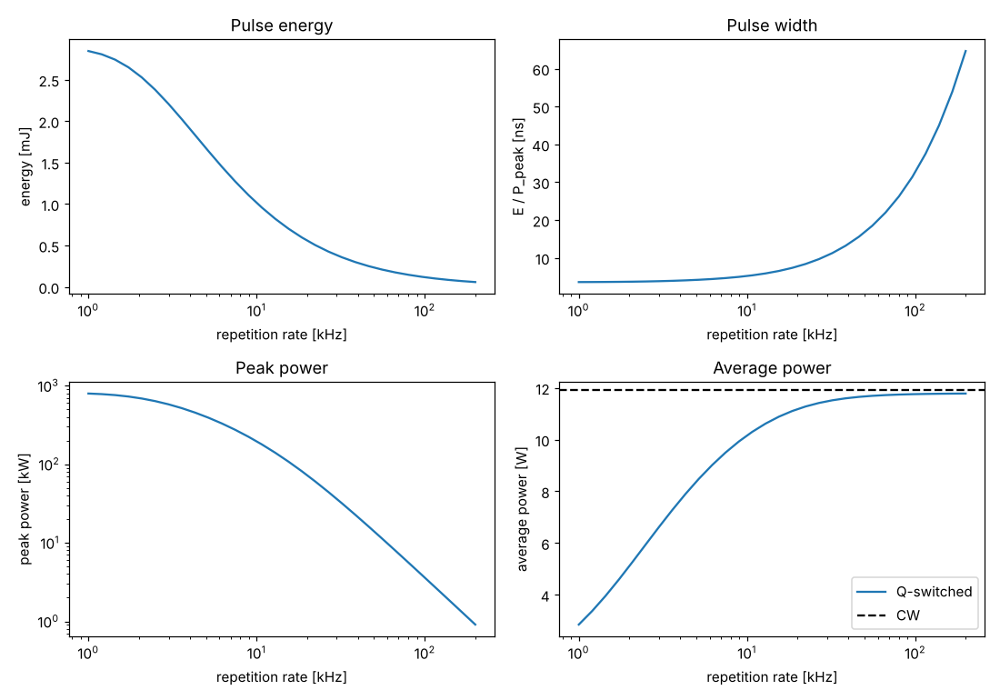
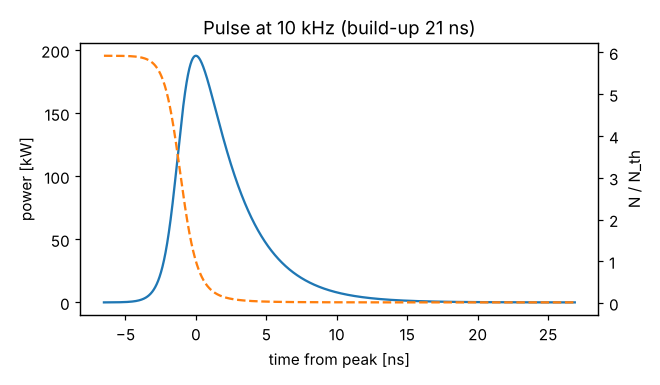

# Q-switched end-pumped Nd:YAG

Script: `examples/qswitched_nd_yag.py`

## Design

| Parameter | Value |
|---|---|
| Gain medium | Nd:YAG, 1 at.%, 8 mm |
| Pump | 20 W at 808 nm, M² = 80, 300 µm waist |
| Resonator | HR on the pumped face, 10 mm gap, 25 mm fused-silica AO Q-switch, 40 mm gap, convex (R = −200 mm) output coupler |
| Output coupling | 20 %, 2 % other losses (including the AOM) |

Nd:YAG's thermal lens is about three times stronger than Nd:YVO4's for the
same absorbed power (larger dn/dT and heat fraction), so a convex output
coupler keeps the resonator stable at full power.

## Results

| Quantity | Value |
|---|---|
| CW output | 11.9 W, M² ≈ 1.6 |
| Round-trip time | 0.67 ns |
| At 10 kHz: energy | 1.0 mJ |
| At 10 kHz: pulse width (E/P) | 5.2 ns (rate-equation FWHM 4.3 ns) |
| At 10 kHz: peak power | 196 kW |
| At 10 kHz: average power | 10.2 W |
| Build-up time | 21 ns |
| Peak fluence on the HR | 4.6 J/cm² (about half a typical 10 J/cm² damage level) |
| Average power at 100 kHz / CW | 0.99 |

## What the design shows

- Below about 3 kHz (repetition period longer than the 230 µs lifetime) the
  pulse energy saturates at about 3 mJ and the average power falls in
  proportion to the repetition rate: the stored energy decays between pulses.
- Above about 20 kHz the average power approaches the CW value while the
  initial inversion falls towards threshold, so pulses lengthen steeply and
  peak power collapses.
- The short cavity gives few-ns pulses. Lengthening it (for example to fit a
  bigger Q-switch) lengthens the pulse in proportion to the round-trip time.

The rate-equation simulation shows the asymmetric pulse (fast rise, slower
fall as the inversion drops below threshold) and the build-up time, which
sets the timing jitter relative to the RF switch-off.

## Things to try

- Change `T_OC`: higher coupling shortens and strengthens pulses at low
  repetition rates, lower coupling helps at high rates.
- Swap in Nd:YVO4: higher gain gives shorter pulses at high repetition rate,
  but the 100 µs lifetime limits the energy at low rates.
