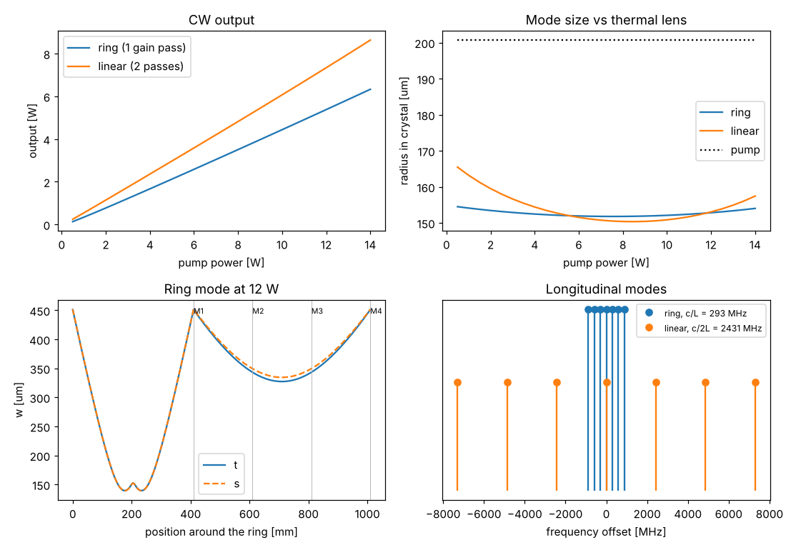

# Unidirectional ring Nd:YVO4 laser

Script: `examples/ring_nd_yvo4.py`. Theory: {doc}`../theory/ring_resonators`.

## Design

| Parameter | Value |
|---|---|
| Gain medium | Nd:YVO4, 0.3 at.%, 10 mm |
| Pump | 12 W at 808 nm, M² = 20, 200 µm waist |
| Ring | bow-tie: two R = 300 mm mirrors 200 mm from the crystal faces, two flat folds, 600 mm long arm, 6° fold angles |
| Output coupling | 5 % (through the flat M2), 3 % other losses (optical diode, mirrors) |
| Linear comparison | HR on the crystal face, 40 mm gap, R = 200 mm output coupler, 1 % other losses |

## Results (12 W pump)

| Quantity | Ring | Linear |
|---|---|---|
| Optical length | 1022 mm (loop) | 66 mm |
| Mode spacing | 293 MHz (c/L) | 2.43 GHz (c/2L) |
| Mode radius in the crystal | 153 µm (153 µm at 2 W) | 153 µm |
| Threshold | 0.129 W | 0.048 W (0.064 W with 3 % loss) |
| Output | 5.4 W | 7.3 W |
| SESAM on M3: repetition rate | 293 MHz | |
| SESAM on M3: QML margin | 0.80 (needs a ~140 µm spot for margin 2) | |

## What the design shows

- **Thermally insensitive ring.** The thermal lens of Nd:YVO4 falls to 77 mm
  at 12 W, yet the ring mode in the crystal changes by less than 1 µm between
  2 and 12 W: the short arm sits where the mode size is stationary with
  respect to the lens.
- **One gain pass.** With equal losses the ring threshold is exactly twice the
  linear one (0.129 against 0.064 W). Above threshold the slope is set by the
  output fraction, not by the number of passes, so most of the output
  difference comes from the optical diode's extra loss.
- **Single frequency.** Without a standing wave there is no spatial hole
  burning, so a ring with an etalon can run on one of the modes spaced
  293 MHz apart.
- **Mode locking.** As a SESAM ring the repetition rate is c/L = 293 MHz. The
  single gain pass raises the QML threshold by √2, and with the large mode on
  the flat fold the margin is only 0.8: the SESAM needs its own focusing
  mirror pair to get the spot down to about 140 µm.
