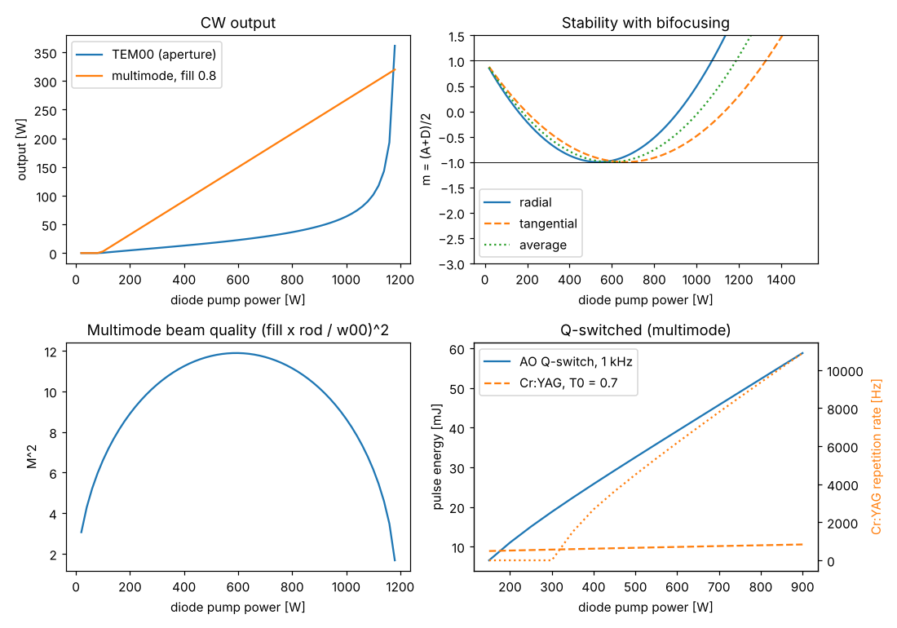

# Side-pumped Nd:YAG rod laser

Script: `examples/side_pumped_nd_yag.py`. Theory: {doc}`../theory/side_pumping`.
For the thermal analysis of a similar rod after Koechner, see
{doc}`koechner_side_pumped_rod`.

## Design

| Parameter | Value |
|---|---|
| Rod | Nd:YAG, 1 at.%, 4 mm diameter, 65 mm long |
| Pump | 808 nm diode bars from three sides, 400 W, 70 % absorbed |
| Resonator | flat HR and flat output coupler, 300 mm from each rod end |
| Output coupling | 20 %, 4 % other losses (AO cell, coatings) |
| Thermal lens in the resonator | average of radial and tangential |
| Multimode beam | fills 80 % of the rod radius |

## Results (400 W pump)

| Quantity | Value |
|---|---|
| Thermal focal length (radial / average / tangential) | 426 / 471 / 527 mm |
| CW threshold | 90 W |
| TEM00 radius in the rod | 0.48 mm |
| TEM00 output (aperture-limited) | 13 W |
| Multimode output | 91 W, M² ≈ 11 |
| Stable pump range (radial / average / tangential) | up to 1060 / 1180 / 1320 W |
| Fracture limit | about 5.8 kW of diode power |
| AO Q-switched at 1 kHz | 26 mJ, 41 ns |
| Cr:YAG (T₀ = 0.7) | 9.5 mJ, 69 ns at 2.7 kHz; threshold 335 W |

## What the design shows

- **TEM00 versus multimode.** The threshold is the same for both (the whole
  rod cross section must reach threshold) but a TEM00 mode with w ≈ 0.5 mm
  extracts only a small part of the 2 mm rod: 13 W against 91 W. Near the
  edge of the stable range the TEM00 mode grows to fill the rod and its
  output rises steeply; the model's rod-clipping loss caps it. That steep
  region is the dynamically stable large-mode design, with a narrow window.
- **Bifocusing.** The radially polarised lens is about 20 % stronger, so the
  radial polarisation leaves the stable zone at 1060 W and the tangential at
  1320 W. An unpolarised multimode laser spreads across both; a polarised
  laser should be designed for the worse case.
- **Beam quality.** M² of the multimode laser is largest in the middle of the
  stable range, where the TEM00 radius is smallest, and approaches 1 near
  the edges.
- **Q-switching.** The large rod stores tens of mJ. The Cr:YAG laser needs
  T₀ = 0.7 or higher to reach threshold at a few hundred W, and then runs at
  a few kHz with ~10 mJ pulses that are fixed by T₀.
