# GUI guide

The `laserdesign` GUI walks you through a design in five steps: gain medium,
pump, resonator, operation and results. Each step shows a live preview that
updates as you type, and you can jump back to any step at any time. It uses
exactly the same models as the library, so a design built in the GUI gives
the same numbers as the equivalent script.

To use the wizard without installing anything, see the {doc}`browser version <web>`.

## Starting the GUI

```bash
python -m pip install -e ".[gui]"
laserdesign-gui                 # or: python -m laserdesign.gui
laserdesign-gui my_design.json  # open a saved design
```

The window opens with the CW Nd:YVO4 example loaded. **Examples** in the menu
bar loads any of seven worked designs from {doc}`examples/index`: CW,
actively and passively Q-switched, SESAM and Kerr-lens mode-locked, a
side-pumped rod and a ring laser.
**File → New** starts a blank design, and **File → Save / Open** stores
designs as JSON files.

The step list on the left and the **Back / Next** buttons move between
steps. Each step, pump geometry, resonator type and operating mode has its
own icon; the red line in each is the laser beam. The status bar shows the design name, or what is wrong with the
current inputs.

## Tutorial: from a crystal to a Q-switched laser

This walk-through rebuilds the {doc}`Q-switched Nd:YAG example
<examples/qswitched_nd_yag>` from scratch. Start with **File → New**.

### Step 1: gain medium

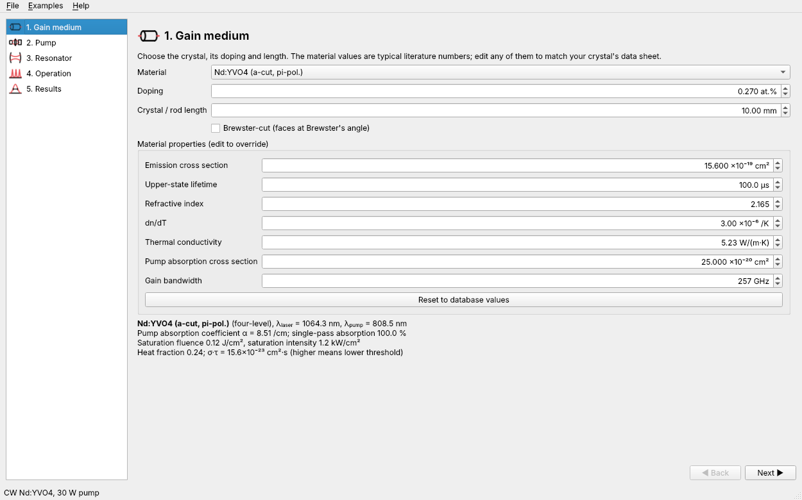

1. Choose **Nd:YAG** as the material. Set the doping to 1.0 at.% and the
   length to 8 mm.
2. The material properties box shows the database values. To use your
   supplier's data, type over any of them; the change is stored with the
   design as an override. **Reset to database values** undoes all overrides.
3. Below the box the page summarises what follows from these numbers: pump
   absorption coefficient, single-pass absorption, saturation fluence and
   the σ·τ product that sets the threshold.

### Step 2: pump

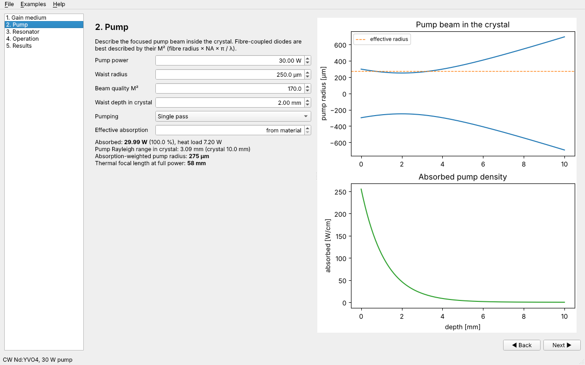

1. Enter 20 W, a 300 µm waist radius, M² = 80 and a waist 2 mm inside the
   crystal. For a fibre-coupled diode, M² ≈ π × fibre core radius × NA / λ.
   A 400 µm, 0.22 NA fibre at 808 nm gives about 170.
2. The plots show the pump caustic in the crystal and where the power is
   absorbed. The summary gives the absorption-weighted pump radius, which is
   the size that matters for threshold and thermal lensing, and the thermal
   focal length at full power.
3. If your diode's spectrum is broad, enter a measured **effective
   absorption** in /cm instead of relying on the narrow-band material value.

### Step 3: resonator

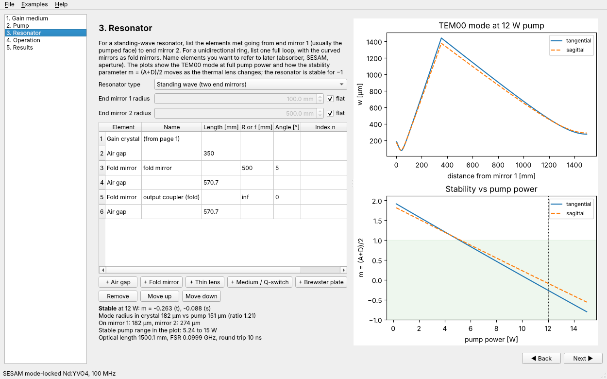

The table lists everything the beam meets going from end mirror 1 (normally
the HR-coated pumped face) to end mirror 2. Use the **+** buttons to insert
elements after the selected row, edit lengths, radii, fold angles and indices
directly in the table, and reorder with **Move up / down**. The gain crystal
row comes from step 1 and cannot be deleted.

For the Q-switched laser:

1. Leave end mirror 1 flat. Set end mirror 2 to −200 mm (a convex output
   coupler) by unticking **flat** and typing the radius.
2. After the crystal, add a 10 mm air gap, a medium of 25 mm and n = 1.45
   named "AO Q-switch", and a 40 mm air gap.

The upper plot shows the TEM00 beam radius over one full round trip at full
pump power, in both planes (they differ only with off-axis curved mirrors or
Brewster plates). For a standing-wave resonator the trace starts on end
mirror 1, runs to end mirror 2 and comes back to mirror 1, so it is
symmetric about M2; for a ring it goes once around the loop. Every element
(the mirrors, the crystal, lenses, media and Brewster plates; not air gaps)
is marked with a dotted line, its name and a circle on the tangential trace.

When the resonator is unstable there is no eigenmode, so the plot follows a
trial beam for a single round trip instead: a beam with the pumped radius
leaving mirror 1 with its wavefront matched to that mirror (for a ring, a
waist at the start of the loop). Its radius at the end differs from the
start, and the trace shows which paraxial element makes it run away, which
helps when deciding what to change to restore stability. The y axis turns
logarithmic when the beam grows by more than a factor of 30. The lower plot shows the stability parameter as the pump power, and
so the thermal lens, changes. The shaded band is the stable zone, and the
dotted line marks your operating point. The summary gives the mode-to-pump
size ratio in the crystal (aim for about 0.8 to 1 for TEM00 with good
efficiency) and the stable pump range.

A typical design loop is to adjust the gap and mirror radius until the
operating point sits comfortably inside the band and the mode ratio is right.

### Step 4: operation

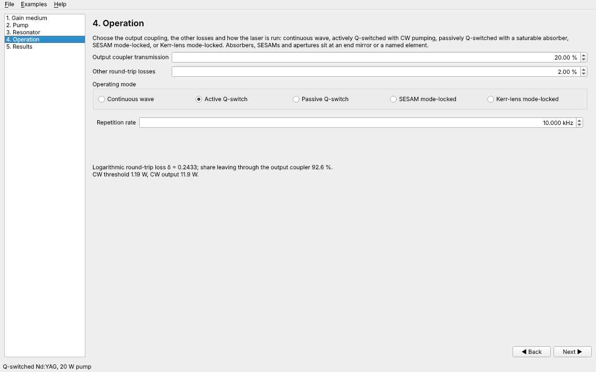

1. Set the output coupler to 20 % and other losses to 2 % (the AOM's
   insertion loss is included here).
2. Choose **Q-switched** and a 10 kHz repetition rate.

For **SESAM mode-locked** operation, enter the SESAM's saturation fluence
and modulation depth and choose where it sits: an end mirror or, for example
in a ring, a named element. The other modes are described in
[Other laser types](#other-laser-types) below.

### Step 5: results

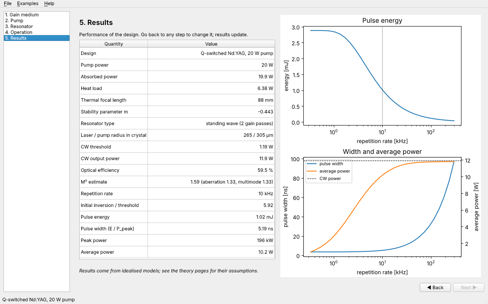

The table lists the operating point (absorbed power, heat load, thermal lens,
paraxial stability, mode sizes), the CW performance and M² estimate, and the
results for the chosen operating mode.

**Paraxial stability (A+D)/2** is m = (A+D)/2 of the round-trip ABCD matrix,
with the crystal and its thermal lens at the chosen pump power. The resonator
is stable for −1 < m < 1. It shows one number when the tangential and
sagittal planes agree and "t / s" when fold angles or Brewster surfaces
split them. Unlike the rest of the table it is defined for an unstable
resonator too, so when the resonator is unstable the Results step still
shows it (with the pump, heat load and thermal lens) and marks it
"unstable"; plotting it against an input, with the stable band shaded, is
the quickest way to see what brings the design back.

The plots depend on the mode:

- **CW:** output power and M² against pump power.
- **Q-switched:** pulse energy, pulse width and average power against
  repetition rate, with your rate marked and the CW power for comparison.
- **SESAM mode-locked:** QML margin and SESAM saturation against pump
  power, with warnings when the design would Q-switch mode lock, damage the
  SESAM or fail to self-start.

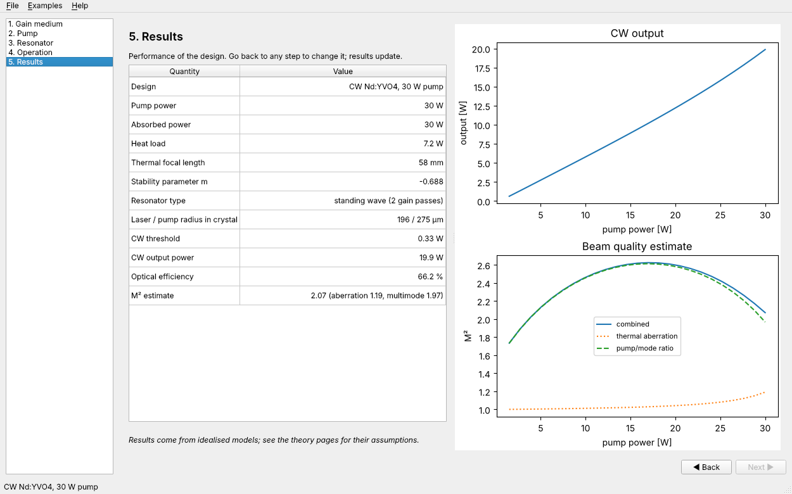

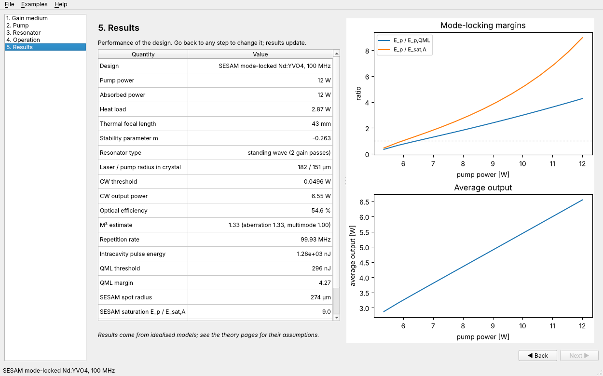

Rest the pointer on a row to see what sets that quantity: a one-line note
on how it is found and the principal inputs behind it, grouped by the step
where you set them and with their current values. The lists follow the
design, so a side-pumped rod shows the rod radius and absorption efficiency
where an end-pumped crystal shows the pump waist and M², and the repetition
rate is an input for active Q-switching but a result (set by the pump and the
absorber) for passive Q-switching. They name the inputs that matter most,
not every one that enters the calculation. The notes are defined in
{mod}`laserdesign.gui.influences`, which both the desktop and the browser
versions use.

(gui-sweep)=
### Plotting a result against an input

The **Plot a result against an input** box under the table turns any of
those notes into a plot. Pick a result (or click its row in the table),
pick one of the inputs that set it, set the range and press **Plot**. The
input is swept over the range with every other input kept as designed, and
the result is drawn on the **Result vs input** tab, with your design marked.
Results that are two numbers (the laser and pump radii, the KLM strength in
the two planes) or a sum of parts (the M² estimate) are drawn as several
curves.

The inputs offered are the ones in the hover note that are continuous
numbers: powers, sizes, losses, the absorber and SESAM settings, the
material constants (swept as overrides of the material) and, for "Resonator
elements and spacings", each air gap, fold-mirror radius and lens focal
length separately (and each fold mirror's angle). Choices such as the material or where the SESAM sits are
not offered. The range starts at a sensible span around the current value
(a decade either side for the Q-switch repetition rate, which is drawn on a
log axis), and you can edit it. Points where the resonator is unstable or
the design is invalid have no result and leave gaps in the curve; the plot
says how many. Once a sweep is on show it is redone whenever you come back
to the Results step, so you can change an input elsewhere and compare.

The sweep is done by {mod}`laserdesign.gui.sweep`, which the browser
version uses too, so scripts can call it directly:

```python
from laserdesign.gui.presets import PRESETS
from laserdesign.gui.sweep import sweep, sweep_inputs

spec = PRESETS["Q-switched Nd:YAG (20 W pump)"]()
print([i.key for i in sweep_inputs("Pulse energy", spec)])
d = sweep("Pulse energy", "rep_rate", spec, lo=1, hi=100)   # kHz, display units
```

Go back to any step, change something, and return: the results are
recomputed from the current inputs.

(design-files)=
## Design files

Designs are saved as readable JSON in SI units, for example:

```json
{
  "name": "Q-switched Nd:YAG, 20 W pump",
  "material": "nd:yag",
  "doping": 1.0,
  "crystal_length": 0.008,
  "pump_power": 20.0,
  "R1": "inf",
  "R2": -0.2,
  "elements": [
    {"type": "crystal"},
    {"type": "space", "length": 0.01},
    {"type": "medium", "length": 0.025, "n": 1.45, "name": "AO Q-switch"},
    {"type": "space", "length": 0.04}
  ],
  "output_coupling": 0.2,
  "mode": "qswitch",
  "rep_rate": 10000.0
}
```

The same file can be used from Python:

```python
from laserdesign.gui.spec import DesignSpec, build_laser

spec = DesignSpec.load("qs.json")
laser = build_laser(spec)                 # an EndPumpedLaser
print(laser.q_switched(spec.pump_power, spec.rep_rate)["energy"])
```

so you can sketch a design in the GUI and then script parameter scans on it.
For a side-pumped design `build_laser` returns a `SidePumpedRodLaser`, and
`laserdesign.gui.spec.kerr_model(spec, f_thermal)` gives the
{class}`~laserdesign.kerr.KerrLensModel` the KLM results use.

(other-laser-types)=
## Other laser types

Each of these has a preset under **Examples** that you can load and modify.

### Side-pumped rods

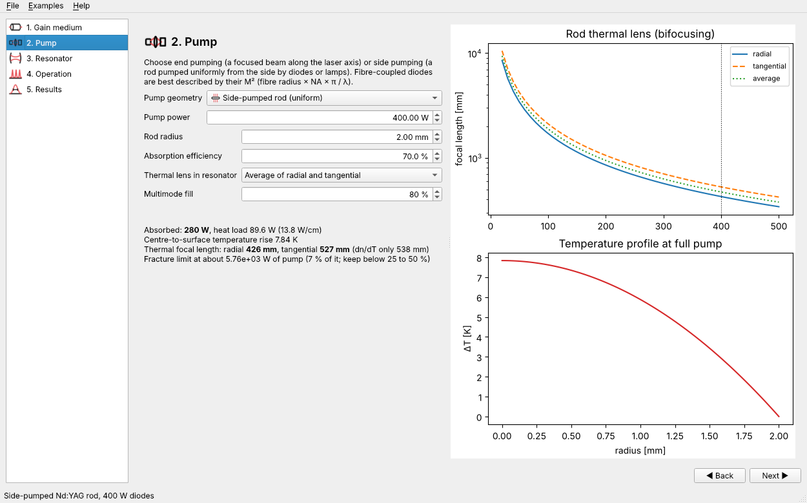

On step 2, set **Pump geometry** to *Side-pumped rod*. The crystal length
from step 1 becomes the rod length. Enter the diode (or lamp) power, the rod
radius and the **absorption efficiency**, the fraction of pump light absorbed
in the rod. **Thermal lens in resonator** chooses which of the bifocal
lenses the resonator uses (see {doc}`theory/side_pumping`); check the radial
and tangential cases for a polarised laser. **Multimode fill** is the
multimode beam radius as a fraction of the rod radius; leave it at *TEM00*
for an aperture-limited single-mode laser, whose clipping at the rod is then
added to the losses. The page plots the bifocal thermal lens against pump
power and the temperature profile, and warns how close you are to the
fracture limit.

### Ring resonators

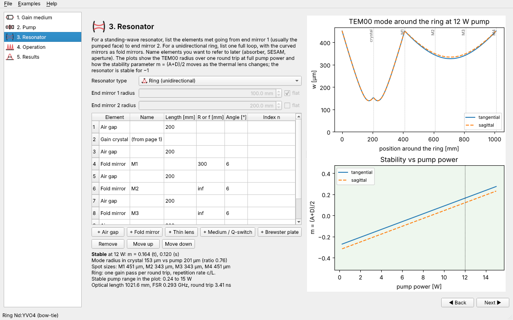

On step 3, set **Resonator type** to *Ring*. The end-mirror radii are then
ignored and the table describes one complete loop; enter the curved mirrors
as fold mirrors with their radius and angle of incidence. Give names to the
mirrors you want to put an output coupler, SESAM, absorber or aperture on.
All results use one gain pass per round trip and a repetition rate of c/L
({doc}`theory/ring_resonators`).

### Brewster-cut crystals

Tick **Brewster-cut** on step 1 for a crystal with Brewster-angled faces
(Ti:sapphire in an X or Z cavity). The crystal length is then the path
inside the crystal, and the resonator includes the crystal's astigmatism.
Compensate it with the fold angle of the curved mirrors around the crystal;
{func}`laserdesign.abcd.astigmatism_compensation_angle` gives the angle.

### Passive Q-switching

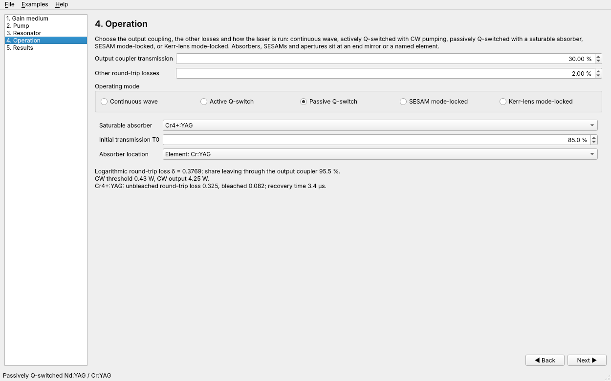

Choose **Passive Q-switch** on step 4, the absorber (Cr⁴⁺:YAG), its
small-signal initial transmission T₀ and where it sits. Usually the absorber
is a *medium* element on step 3 (for example 2 mm of n = 1.82, named
"Cr:YAG"); the mode size is read there. The results give the bleaching
criterion (must exceed 1), the threshold with the unbleached absorber, pulse
energy, width, peak power, repetition rate and average power, and plot the
repetition rate against pump power and the energy and width against T₀
({doc}`theory/passive_qswitching`).

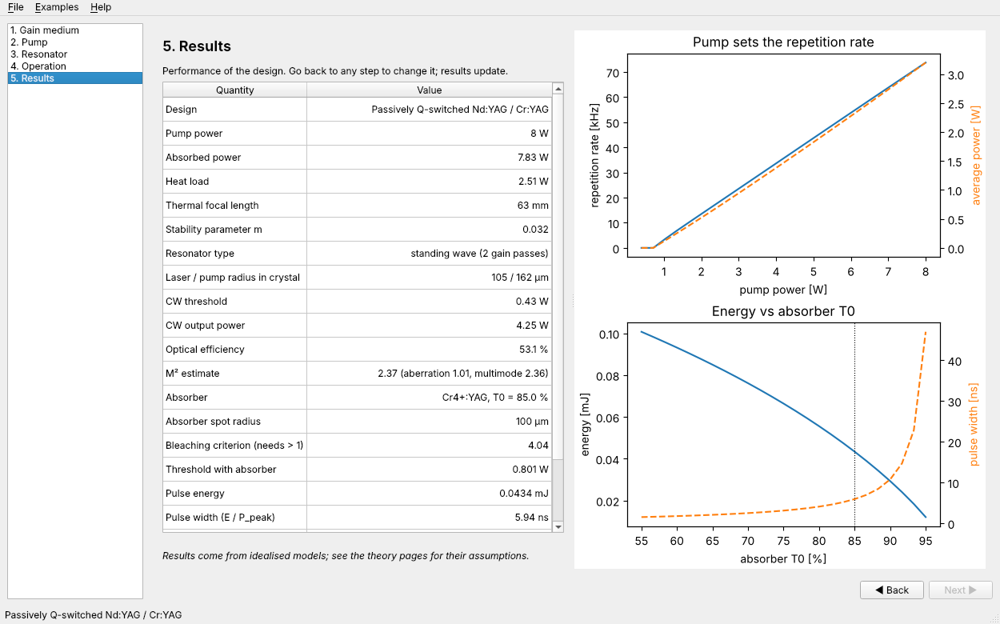

### Kerr-lens mode locking

Choose **Kerr-lens mode-locked** on step 4. Pick the **aperture** where the
Kerr effect is read: an end mirror or named element for a hard aperture, or
*Gain crystal* for soft-aperture KLM. **Crystal slices** sets how finely the
Kerr lens is resolved (6 is usually enough), and **Target pulse width** sets
the soliton dispersion estimate. The results give the critical power, the KLM
strength δ at the aperture and in the crystal for both planes, the
intracavity pulse energy and peak power, and the net GDD needed. The plots
show the self-consistent mode size against normalised power and how δ changes
with pump power through the thermal lens ({doc}`theory/kerr_lens`).

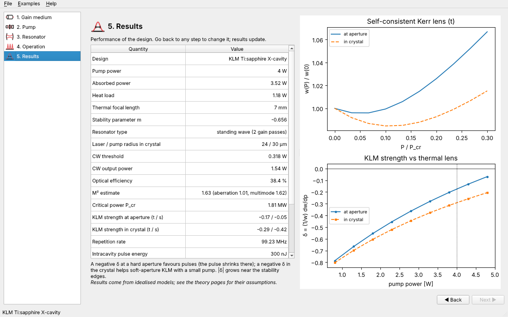

## Limitations

- The results are only as accurate as the models; see the theory pages for
  their assumptions. In particular the KLM figures describe the onset of the
  Kerr effect, not the mode-locked pulse.
- A Brewster-cut crystal's thermal lens is applied in the reduced
  (equivalent-beam) frame without the extra tangential scaling.
