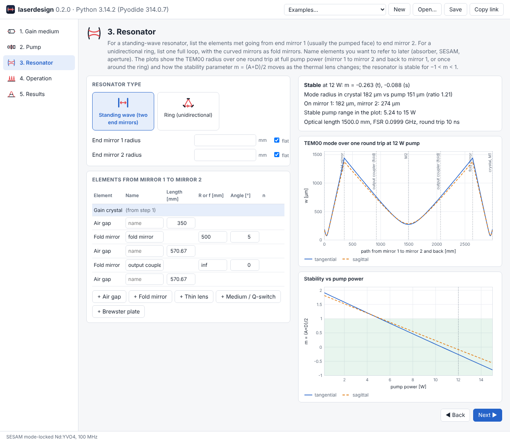
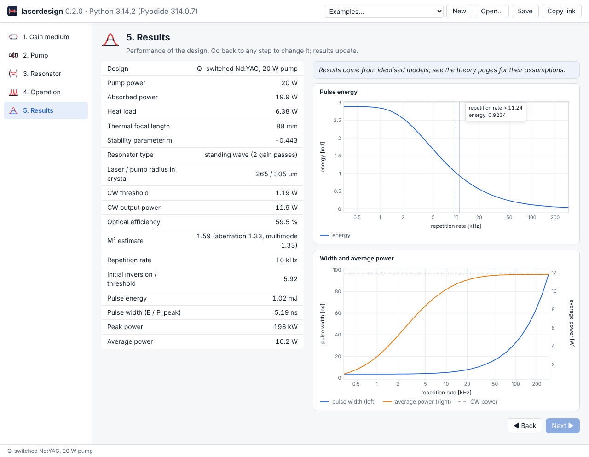

# Browser version

The same five-step wizard as the {doc}`Qt GUI <gui>` also runs in a web
browser. Nothing is installed and nothing runs on a server: the page loads
[Pyodide](https://pyodide.org), a build of CPython for WebAssembly, and runs
the `laserdesign` package, NumPy and SciPy inside the browser. The numbers
are therefore identical to the library's and the desktop GUI's.



## Using it

Open the site (see [Hosting](#hosting) below, or run it locally) and wait for
the first load: it downloads Python, NumPy and SciPy, about 30 MB, which the
browser then caches. After that a design is computed as you type.

The steps, inputs and results follow the {doc}`GUI guide <gui>`, which is
also the tutorial for the browser version. The differences:

- **Examples…** loads any of the seven worked designs; **New** starts a blank
  design.
- **Save** downloads the design as a JSON file and **Open…** loads one. The
  files are the same as the desktop GUI's, so you can move designs between
  the two and into Python with `DesignSpec.load` (see
  {ref}`design files <design-files>`).
- **Copy link** copies a link with the whole design encoded in it, for
  sending a design to a colleague.
- The current design is kept in the browser between visits.
- On step 3 each element row has its own ↑, ↓ and ✕ buttons, and a mirror
  radius of `inf` means flat.
- Plots show the values under the pointer.
- On the Results step, hovering over a row (or tapping it, or focusing it
  with the keyboard) shows the inputs that set that quantity, and the
  **Plot a result against an input** box below the table sweeps one of
  those inputs and plots the result above the step's own plots (see
  {ref}`the desktop guide <gui-sweep>`; it works the same way).
- The Results step's KLM case takes a few seconds, since it re-solves the
  Kerr-lensed resonator at several pump powers.



## Running it locally

```bash
python tools/build_web.py --serve
```

builds the site into `build/web/` and serves it at <http://localhost:8000>.
The page must be served over HTTP; opening `index.html` as a file does not
work, because browsers do not let pages start Web Workers or fetch files
from `file://` URLs. Any static server will do, for example
`python -m http.server -d build/web`.

By default the site loads Pyodide from the jsDelivr CDN. To use it without
internet access (an isolated lab network, a laptop on the road), copy Pyodide
into the site:

1. Download `pyodide-314.0.7.tar.bz2` from the
   [Pyodide releases](https://github.com/pyodide/pyodide/releases/tag/314.0.7)
   and unpack it.
2. Build with
   ```bash
   python tools/build_web.py --pyodide-dir path/to/pyodide
   ```
   This copies only the runtime, NumPy and SciPy (about 30 MB) into
   `build/web/pyodide/`.

`--pyodide-url URL` points the site at another Pyodide copy, and adding
`?pyodide=URL` to the page's address does the same for one visit.

(hosting)=
## Hosting

`build/web/` is a plain static site: copy it to any web server. The
repository's `pages` workflow publishes it to GitHub Pages on every push to
`main`. To turn this on once, open the repository's **Settings → Pages** and
set **Source** to **GitHub Actions**. The site then appears at
`https://<user>.github.io/laser-design/`.

## How it works

```text
index.html, app.js      forms, plots, file handling (JavaScript, main thread)
        │  JSON
worker.js               Web Worker: loads Pyodide, NumPy, SciPy, laserdesign.zip
        │
laserdesign.web.api     catalog(), normalise(spec), run(spec, step), sweep(spec, request)
laserdesign.web.report  one report per step: summary lines, result rows, plot data
laserdesign.gui.influences  which inputs set each result row (the hover notes)
laserdesign.gui.sweep   a result row against one of those inputs (the sweep plot)
laserdesign.gui.spec    DesignSpec -> EndPumpedLaser / SidePumpedRodLaser
```

The page keeps the design as the same JSON that design files use and sends
it to the worker whenever an input changes. The worker calls
{func}`laserdesign.web.api.run`, which builds the laser with
{func}`~laserdesign.gui.spec.build_laser` and returns the step's report:
summary lines, the results table and the data for each plot. `plot.js` draws
the plots as SVG. Running Python in a worker keeps the page responsive
during longer calculations.

`tools/build_web.py` copies `web/`, the icons from `laserdesign/gui/icons/`
and a zip of the package's Python files into the output folder, and writes
`config.js` with the Pyodide location. The Python side is tested like the
rest of the library (`tests/test_web.py`); it needs neither Qt nor
matplotlib.

To change what a step shows, edit {mod}`laserdesign.web.report`; the page
draws whatever lines, rows and plots the report returns.

## Browser support

Current Chrome, Edge, Firefox and Safari (anything that supports WebAssembly
and module Web Workers, roughly 2023 and newer). The layout also works on a
phone, though the resonator table is easier to edit on a larger screen.
